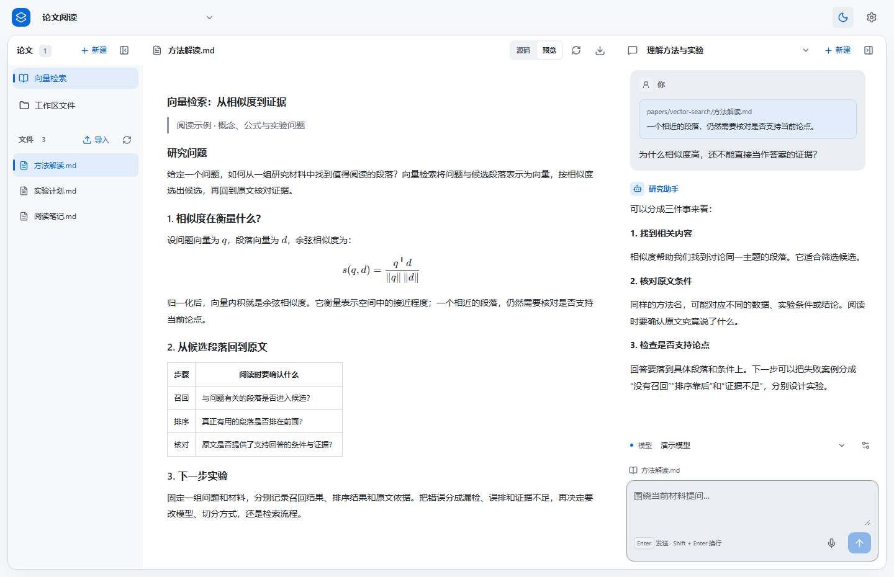

<div align="center">

# hxaxd-research

<p><b>中文</b> &nbsp;·&nbsp; <a href="README.en.md">English</a></p>

<h3>在移动设备上，用语音推进整个科研过程。</h3>

<p>自己的电脑 · 自己的网络 · 自己的算力</p>

<p>
  <a href="#快速开始"><b>开始使用</b></a> &nbsp;·&nbsp;
  <a href="#为什么选择它">为什么选择它</a> &nbsp;·&nbsp;
  <a href="#从一个研究问题开始">使用示例</a> &nbsp;·&nbsp;
  <a href="https://github.com/hxaxd/hxaxd-research/issues">反馈与建议</a>
</p>

<sub>浏览器使用 &nbsp; / &nbsp; ChatGPT 订阅 &nbsp; / &nbsp; <a href="https://github.com/hxaxd/remote-everything">Remote Everything</a> 提供移动设备支持 &nbsp; / &nbsp; 横屏平板适配</sub>

</div>

找论文、翻译论文、学懂论文，围绕自己的想法设计实验、写代码、运行并分析结果，最后写成论文、投稿与发表。hxaxd-research 的目标，是让你在任何能接入自己研究环境的地方，拿起移动设备、开口说出需求，就能和 AI 一起推进这条完整的科研链路。

<picture>
  <source media="(prefers-color-scheme: dark)" srcset=".github/assets/workbench-dark.png">
  <source media="(prefers-color-scheme: light)" srcset=".github/assets/workbench-light.png">
  
</picture>

<p align="center"><sub>乏善可陈，但是熟悉而舒适的界面。</sub></p>

你在移动设备上阅读、提问和作决定，AI 在你自己的电脑上处理文件、运行代码，使用你的网络和算力，并将成果展示给你。

## 为什么选择它

<table>
  <tr>
    <td width="50%" valign="top">
      <h3>随身接入自己的研究环境</h3>
      <p>工作台运行在自己的电脑上，通过浏览器使用。配合 <a href="https://github.com/hxaxd/remote-everything">Remote Everything</a>，从移动设备接入，让文件、依赖和计算任务留在原来的环境里。</p>
      <p><sub>纯浏览器 · 移动访问 · 私有计算环境</sub></p>
    </td>
    <td width="50%" valign="top">
      <h3>看着材料，直接开口推进</h3>
      <p>页面内语音输入，助手自动获取当前文件与 PDF 页码。选中一句话、框出一张图就能提问，生成的成果直接打开查看，减少切屏和上下文搬运。</p>
      <p><sub>语音输入 · 选段引用 · 同屏协作</sub></p>
    </td>
  </tr>
  <tr>
    <td width="50%" valign="top">
      <h3>拿起平板，舒适地读下去</h3>
      <p>针对横屏平板适配布局和触屏操作，核心操作不依赖鼠标或硬件键盘。收起侧栏、调整栏宽，连续阅读与讨论，照顾长时间使用。</p>
      <p><sub>触屏操作 · 连续阅读 · 明暗外观</sub></p>
    </td>
    <td width="50%" valign="top">
      <h3>复用已经在用的 ChatGPT 订阅</h3>
      <p>连接 ChatGPT，使用符合条件的订阅额度推进科研。也支持其他模型供应商与兼容 API，语音服务可独立配置。</p>
      <p><sub>订阅复用 · 多模型选择 · 可配置语音</sub></p>
    </td>
  </tr>
</table>

### 论文翻译的两个核心设计

1. **优先拿到原始内容，再翻译与重新编译。** 寻找论文的 TeX 工程或官方 HTML，直接翻译成中文：TeX 保留工程结构并重新编译，HTML 翻译后重新渲染。只有找不到这些来源、仅有 PDF 时，才使用 OCR。尽量从源头保留准确的文本、公式、引用和章节关系，减少识别与版面重建带来的误差。
2. **把原始文本交给强模型，译出准确、易懂且有学术品味的中文。** 结合全文上下文理解概念与论证，保持术语一致，保留原文的逻辑与细节，同时让中文表达自然、清晰，便于真正读懂论文。

## 快速开始

在运行工作台的电脑上准备 **Node.js 24+** 和 Git。

```sh
git clone https://github.com/hxaxd/hxaxd-research.git
cd hxaxd-research
```

| Windows（PowerShell） | macOS / Linux（Shell） |
| --- | --- |
| `powershell -ExecutionPolicy Bypass -File .\install.ps1` | `sh ./install.sh` |

脚本安装依赖、初始化运行配置与模板，并完成生产构建。启动：

```sh
npm start -- --hostname 127.0.0.1 --port 8642
```

默认监听地址为 `127.0.0.1`，端口为 `8642`。打开 **<http://127.0.0.1:8642>**。

## 从一个研究问题开始

1. 新建工作区并导入材料，导入 PDF、文档或完整材料目录。
2. 打开材料，选中一段话或框选图片，输入问题；也可以点麦克风说话。
3. 让助手把讨论整理成笔记、译稿或写作草稿，或进一步编写实验脚本；在同一工作区查看结果、修改并继续推进。

<details open>
<summary><b>找论文 → 翻译 → 一起读懂</b></summary>

> 帮我找与这个小目标检测的论文，下载到工作区，挑一篇最值得先读的打开。

> 直接翻译这篇论文，然后我们从方法部分开始一节一节读。

</details>

<details>
<summary><b>一个想法 → 设计实验 → 编码验证</b></summary>

> 我想把刚才讨论的模块换成这个方案。先帮我设计一个能验证它的最小实验，我们确定后就写代码运行。

</details>

<details>
<summary><b>文献与实验记录 → 论文草稿</b></summary>

> 根据已有文献、代码和实验记录，整理方法与实验部分的初稿，标出缺少证据的结论，一起修改论文。

</details>

## 资料与使用范围

<details>
<summary><b>资料保存、模型调用与运行权限</b></summary>

- **本地保存**：材料、对话与模型凭据默认保存在 `.runtime/data/`，可在 `.runtime/config.jsonc` 中修改 `dataDir`。备份时保留整个数据目录。
- **高级配置**：安装时从 Git 中的[默认配置模板](config.default.jsonc)自动创建 `.runtime/config.jsonc`，已有配置不会覆盖。技能、提示词和 HTML 模板由 Git 源文件安装至 `.runtime/templates/`，重装会更新这些模板；长期修改请编辑对应源文件。在运行配置中调整数据、环境、暂存目录，以及文件大小限制、请求超时、重试和 OCR 设备；修改后重启。执行 `node src/app/config.mjs --defaults` 查看完整默认配置，执行 `node src/app/config.mjs` 查看实际路径。相对路径以项目根目录为准，仅需指定其他配置文件时使用 `APP_CONFIG_FILE`。改目录不搬迁已有资料或环境。
- **模型调用**：使用云端服务时，相关上下文会发送给你选择的供应商。
- **个人使用**：平台无需注册账号，默认仅监听本机。Agent 可访问运行账号有权操作的文件和程序。

</details>

## 参与项目

欢迎分享你的科研使用场景、提交体验反馈或贡献代码。问题与建议请提交到 [Issues](https://github.com/hxaxd/hxaxd-research/issues)。

<p align="center">
  <a href="LICENSE">MIT License</a> &nbsp;·&nbsp; © 2026 hxaxd
</p>
